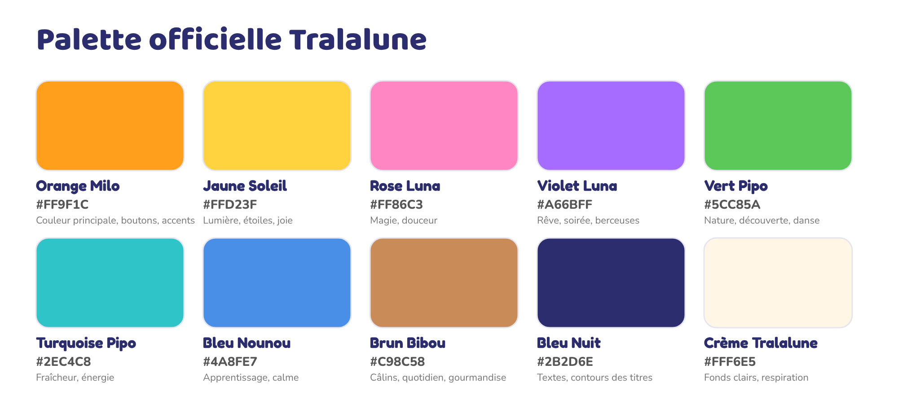
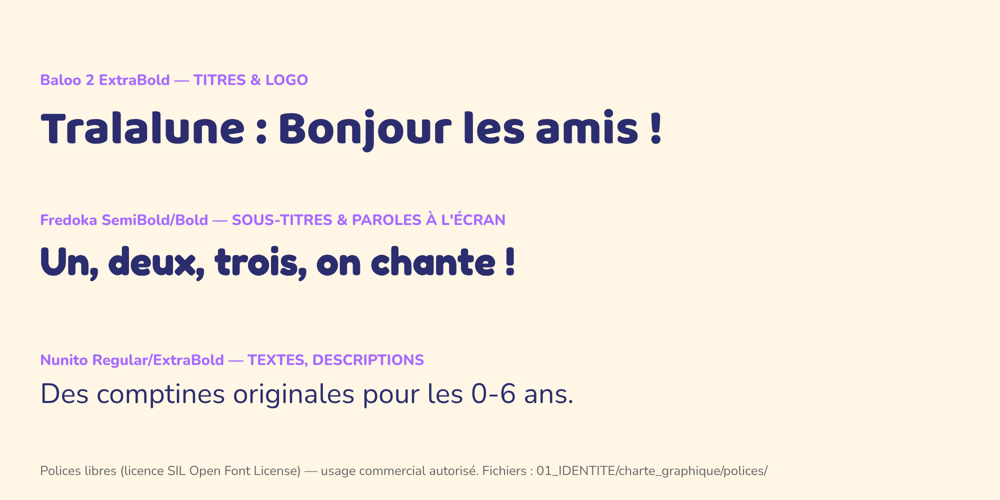

# Charte graphique Tralalune

> Version imprimable : `charte_graphique_Tralalune.pdf` (même dossier).

## 1. Logo
| Version | Fichier | Usage |
|---|---|---|
| Officielle (avec personnages) | `../logo/logo_officiel_2000x1100.png` / `logo_officiel_transparent.png` | Bannière, intro des vidéos, documents, merchandising |
| Simplifiée (nom + lune) | `../logo/logo_simplifie_transparent.png` / `_fond_nuit.png` | Petits formats, filigrane, fin de vidéo, réseaux |
| Monogramme | `../logo/monogramme_lune_note.png` | Favicon, tampon, coin des miniatures, très petits formats |

**Règles**
- Zone de protection : un espace vide égal à la hauteur de la lettre « a » tout autour du logo.
- Taille minimale : 240 px de large (officiel), 120 px (simplifié), 32 px (monogramme).
- Sur fond chargé, utiliser une version sur pastille blanche (comme le repère des miniatures).
- Interdits : déformer, changer l'ordre des couleurs des lettres, retirer le contour bleu nuit, ajouter une ombre portée dure, remplacer la police.

## 2. Palette officielle

| Nom | HEX | RVB | Rôle |
|---|---|---|---|
| Orange Milo | `#FF9F1C` | 255, 159, 28 | Couleur principale, boutons, accents |
| Jaune Soleil | `#FFD23F` | 255, 210, 63 | Lumière, étoiles, titres sur fond sombre |
| Rose Luna | `#FF86C3` | 255, 134, 195 | Magie, douceur |
| Violet Luna | `#A66BFF` | 166, 107, 255 | Rêve, soirée, berceuses |
| Vert Pipo | `#5CC85A` | 92, 200, 90 | Nature, découverte, danse |
| Turquoise Pipo | `#2EC4C8` | 46, 196, 200 | Fraîcheur, énergie |
| Bleu Nounou | `#4A8FE7` | 74, 143, 231 | Apprentissage, calme |
| Brun Bibou | `#C98C58` | 201, 140, 88 | Câlins, quotidien |
| **Bleu Nuit** | `#2B2D6E` | 43, 45, 110 | Textes et contours de titres (remplace le noir) |
| Crème Tralalune | `#FFF6E5` | 255, 246, 229 | Fonds clairs |

Règles : jamais de noir pur (#000) ; maximum 3 couleurs dominantes par image + bleu nuit pour le texte ; les vidéos du soir utilisent la gamme violet/bleu nuit/jaune doux.

## 3. Typographies (toutes sous licence SIL Open Font License → usage commercial libre)

| Police | Graisse | Usage | Fichier |
|---|---|---|---|
| **Baloo 2** | ExtraBold 800 | Logo, titres de miniatures, gros titres | `polices/baloo-2-latin-800-normal.woff2` |
| **Fredoka** | SemiBold 600 / Bold 700 | Sous-titres, paroles à l'écran (karaoké), boutons | `polices/fredoka-latin-*.woff2` |
| **Nunito** | Regular 400 / Bold 700 / ExtraBold 800 | Textes longs, descriptions, documents | `polices/nunito-latin-*.woff2` |

Téléchargement complet (formats TTF pour logiciels de montage) : [fonts.google.com](https://fonts.google.com) → Baloo 2, Fredoka, Nunito.

## 4. Style d'illustration
- 3D cartoon « peluche » : formes rondes, fourrure douce, grands yeux brillants à deux reflets, lumière chaude et enveloppante.
- Proportions chibi : tête = 55 % de la hauteur.
- Contours doux de couleur (jamais noirs). Ombres colorées (violettes/bleutées), jamais grises.
- Décors : détaillés au premier plan, flous en arrière-plan (profondeur de champ), jamais surchargés.
- Lumière : matin = doré, journée = ciel bleu, soir = violet/bleu nuit avec lune jaune.

## 5. Mise en page des titres à l'écran
- Titres : Baloo 2, remplissage blanc ou jaune, contour bleu nuit épais (≈ 1/7 de la taille), légère rotation (-2° à -4°) pour le dynamisme.
- Paroles karaoké : Fredoka Bold, blanc, contour bleu nuit 4 px, en bas de l'écran (marge 8 %), le mot chanté passe en jaune soleil.
- Toujours au moins 5 % de marge par rapport aux bords (zones de sécurité TV).

## 6. Bannière & photo de profil
- Bannière 2560×1440 : nom + slogan **dans la zone de sécurité 1546×423** (voir `../banniere/banniere_GUIDE_zones_securite.png`).
- Photo de profil 800×800 : Milo en gros plan, lisible même à 40 px (voir `../photo_profil/test_lisibilite_petit_format.png`).

## 7. Miniatures
Voir `03_MINIATURES/SYSTEME_MINIATURES.md`.
