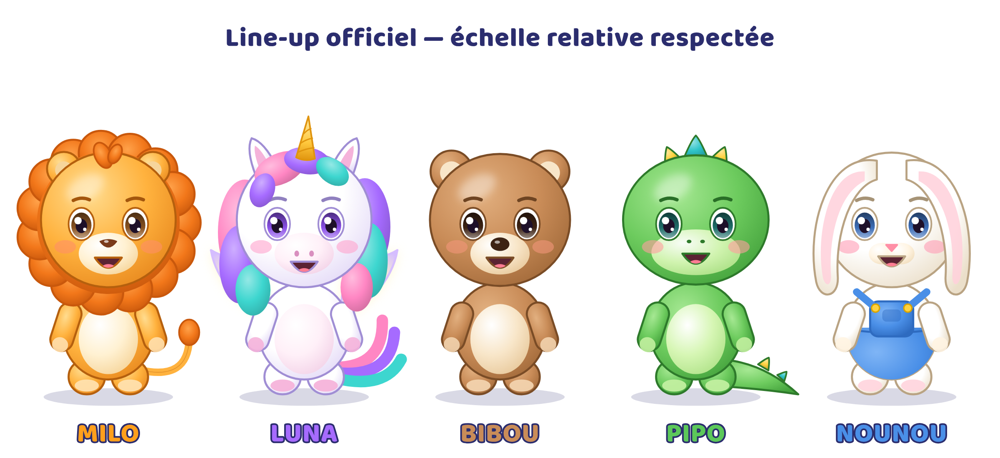

# BIBLE DES PERSONNAGES — Tralalune

## La bande des copains
| Personnage | Espèce | Rôle | Pas de danse | Réplique |
|---|---|---|---|---|
| **Milo** | petit lion | Personnage principal et mascotte. Ouvre et ferme la plupart des vidéos, présente les chansons. | Le saut du lion (s'accroupir, « grrr », sauter bras en l'air) | « Coucou les copains ! » / « Grrr… hop ! » |
| **Luna** | petite licorne | Chansons magiques, émotions, berceuses et histoires du soir. | La pirouette magique (tourner sur soi, traînée d'étincelles) | « Fais de beaux rêves, petit cœur. » |
| **Bibou** | petit ourson | Chansons amusantes, comptines du quotidien (repas, bain, ferme, rangement). | Le dandin du nounours (mains sur les hanches, faire tourner son ventre) | « Miam ! » / « Oups… hi hi ! » |
| **Pipo** | petit dinosaure | Chansons pour apprendre, danser et découvrir (sciences, espace, nature, mouvements). | Le boum du dino (taper des pieds en rythme) | « Rooar ! Rigolo ! » / « On y va ? » |
| **Nounou** | petit lapin | Apprentissage : chiffres, couleurs, formes, lettres, routines (dents, rangement). | Les oreilles qui volent (battre des bras, les oreilles se soulèvent) | « Bravo, tu as réussi ! » |

## Dynamique du groupe
- **Milo** entraîne, **Nounou** explique, **Pipo** questionne et bouge, **Bibou** fait rire, **Luna** apaise et fait rêver.
- Paires récurrentes : Milo & Pipo (énergie, aventure) · Luna & Nounou (calme, apprentissage) · Bibou & Pipo (duo comique).
- Aucun personnage n'est jamais méchant, moqué ou exclu. Les petits conflits se règlent en moins de 20 secondes, avec un câlin ou un rire.
- **Ordre officiel** sur les plans de groupe (de gauche à droite) : Luna, Bibou, **Milo (centre, devant)**, Pipo, Nounou.

## Règles de cohérence absolue
1. Les fichiers de `02_PERSONNAGES/` sont la **seule référence**. Toute image générée est comparée à la planche de rotation avant validation.
2. Les couleurs hexadécimales des fiches sont verrouillées. Elles sont définies une seule fois dans `_outils/art.py`.
3. Proportions chibi : tête = 55 % de la hauteur pour les 5 personnages ; Milo est le plus grand (crinière), Bibou le plus large.
4. Seule Nounou porte un vêtement (salopette bleue). Les autres ne portent rien, hors accessoires temporaires.
5. Un plan raté (doigts en trop, couleur fausse, corne mal placée…) est **régénéré**, jamais publié.
6. Les voix sont attribuées une fois pour toutes (même modèle de voix / même réglage) et notées dans `08_PROMPTS/WORKFLOW_PRODUCTION.md`.

## Évolution sur plusieurs années (sans casser la marque)
- Saison 2 : nouveaux décors de l'île (plage, forêt, montagne enneigée), personnages secondaires (ex. une petite tortue facteur, des lucioles), toujours avec la même grammaire visuelle.
- Saisons spéciales : Noël, Halloween « tout doux », été — en accessoires temporaires uniquement.
- Déclinaisons possibles : livres, peluches, coloriages, version anglaise (« Tralalune » reste prononçable partout).
