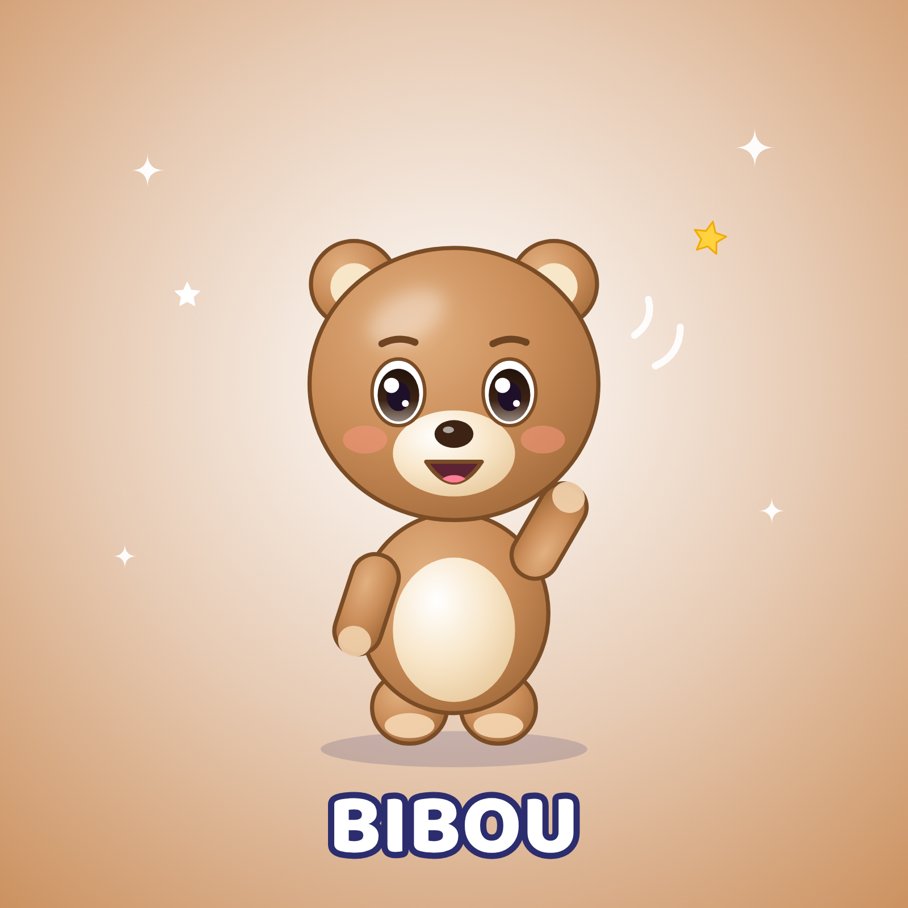

# Bibou — petit ourson · Fiche d'identité officielle

## Identité
| | |
|---|---|
| Nom | **Bibou** |
| Espèce | petit ourson |
| Âge (ressenti) | Équivalent 3 ans |
| Rôle | Chansons amusantes, comptines du quotidien (repas, bain, ferme, rangement). |
| Personnalité | Gourmand, rigolo, câlin, maladroit. Il fait des bêtises tendres dont il rit lui-même. |
| Petit défaut attachant | Gourmand : il goûte tout en cachette (sans jamais être puni ou moqué méchamment). |
| Aime | Le miel, les câlins, les siestes, les animaux de la ferme. |
| Réplique signature | « Miam ! » / « Oups… hi hi ! » |
| Pas de danse signature | Le dandin du nounours (mains sur les hanches, faire tourner son ventre) |
| Voix | Voix ronde, un peu grave pour un enfant, gourmande et rieuse. |
| Façon de bouger | Lourdaud et moelleux, se dandine, petites chutes sans gravité (comique doux). |

## Proportions (verrouillées)
- Hauteur totale = **1 unité** ; tête = **55 %** de la hauteur (style « chibi »), corps = 30 %, jambes = 15 %.
- Yeux grands, écartés, placés juste sous le milieu de la tête ; deux reflets blancs (un grand en haut à gauche, un petit en bas à droite).
- Bras courts arrondis (n'atteignent pas le sommet de la tête même levés), pas de doigts visibles : pattes arrondies avec coussinets.
- Contour doux de la couleur « Contour » (jamais noir pur).

## Palette verrouillée
| Élément | Couleur |
|---|---|
| Base fourrure | `#C98C58` |
| Lumière | `#E2B080` |
| Ombre | `#A26A3A` |
| Contour | `#7A4C26` |
| Ventre / museau | `#F8E6C9` |
| Coussinets / sabots | `#F2D3AE` |
| Yeux (iris) | `#3D2314` |
| Nez | `#3D2314` |
| Joues | `#F2967A` |

## À ne JAMAIS faire
- Ne jamais se moquer de sa corpulence ; la gourmandise est un trait attachant, pas une leçon de régime.
- Changer les couleurs, ajouter des vêtements ou accessoires permanents, modifier la forme des oreilles/yeux, ajouter des doigts.
- Le montrer dans une situation dangereuse, effrayante ou de moquerie.
- Accessoires **temporaires** autorisés quand l'histoire l'exige (chapeau de fête, brosse à dents, pinceau), retirés ensuite.

## Fichiers de référence (dans ce dossier)
| Fichier | Usage |
|---|---|
| `bibou_illustration_officielle.png` | Visuel officiel 1600×1600 (réseaux, présentation) |
| `bibou_vue_face.png` · `bibou_vue_profil.png` · `bibou_vue_dos.png` | Vues sur fond blanc = **images de référence à joindre aux IA** |
| `bibou_vue_face_transparent.png` | Détourage pour montage/miniatures |
| `bibou_planche_rotation.png` | Turnaround face/profil/dos avec repères de proportions |
| `bibou_expressions.png` | 8 expressions officielles |
| `bibou_poses.png` | 6 poses de référence |
| `bibou_fiche_identite.png` | Fiche visuelle avec palette |
| `PROMPT_MAITRE.md` | Prompt de reproduction à utiliser tel quel |
