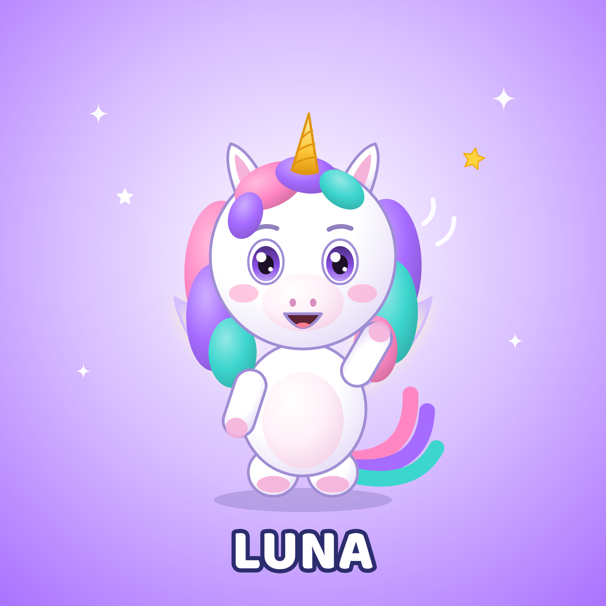

# Luna — petite licorne · Fiche d'identité officielle

## Identité
| | |
|---|---|
| Nom | **Luna** |
| Espèce | petite licorne |
| Âge (ressenti) | Équivalent 4 ans |
| Rôle | Chansons magiques, émotions, berceuses et histoires du soir. |
| Personnalité | Douce, rêveuse, imaginative, gentille. Elle remarque quand quelqu'un est triste et trouve les mots pour consoler. |
| Petit défaut attachant | Un peu tête en l'air : elle rêvasse et rate parfois le début du jeu. |
| Aime | La lune, les étoiles, les nuages en forme d'animaux, chanter tout bas. |
| Réplique signature | « Fais de beaux rêves, petit cœur. » |
| Pas de danse signature | La pirouette magique (tourner sur soi, traînée d'étincelles) |
| Voix | Voix féminine douce et chaleureuse, légèrement aérienne, très proche du micro pour les berceuses. |
| Façon de bouger | Fluide, léger, flotte presque ; ailes qui scintillent doucement (jamais de vol rapide). |

## Proportions (verrouillées)
- Hauteur totale = **1 unité** ; tête = **55 %** de la hauteur (style « chibi »), corps = 30 %, jambes = 15 %.
- Yeux grands, écartés, placés juste sous le milieu de la tête ; deux reflets blancs (un grand en haut à gauche, un petit en bas à droite).
- Bras courts arrondis (n'atteignent pas le sommet de la tête même levés), pas de doigts visibles : pattes arrondies avec coussinets.
- Contour doux de la couleur « Contour » (jamais noir pur).

## Palette verrouillée
| Élément | Couleur |
|---|---|
| Base fourrure | `#FFFFFF` |
| Lumière | `#FFFFFF` |
| Ombre | `#E4DAF7` |
| Contour | `#A08ED4` |
| Ventre / museau | `#FFF0F8` |
| Coussinets / sabots | `#F5B3DA` |
| Yeux (iris) | `#8B50E8` |
| Nez | `#D98FBF` |
| Joues | `#FFA3CD` |
| Mèche rose | `#FF86C3` |
| Mèche violette | `#A66BFF` |
| Mèche turquoise | `#3DD6CF` |
| Corne | `#FFC83D` |
| Ailes | `#FFF6C9` |

## À ne JAMAIS faire
- Jamais d'autres couleurs de crinière que rose/violet/turquoise ; la corne reste dorée et petite.
- Changer les couleurs, ajouter des vêtements ou accessoires permanents, modifier la forme des oreilles/yeux, ajouter des doigts.
- Le montrer dans une situation dangereuse, effrayante ou de moquerie.
- Accessoires **temporaires** autorisés quand l'histoire l'exige (chapeau de fête, brosse à dents, pinceau), retirés ensuite.

## Fichiers de référence (dans ce dossier)
| Fichier | Usage |
|---|---|
| `luna_illustration_officielle.png` | Visuel officiel 1600×1600 (réseaux, présentation) |
| `luna_vue_face.png` · `luna_vue_profil.png` · `luna_vue_dos.png` | Vues sur fond blanc = **images de référence à joindre aux IA** |
| `luna_vue_face_transparent.png` | Détourage pour montage/miniatures |
| `luna_planche_rotation.png` | Turnaround face/profil/dos avec repères de proportions |
| `luna_expressions.png` | 8 expressions officielles |
| `luna_poses.png` | 6 poses de référence |
| `luna_fiche_identite.png` | Fiche visuelle avec palette |
| `PROMPT_MAITRE.md` | Prompt de reproduction à utiliser tel quel |
