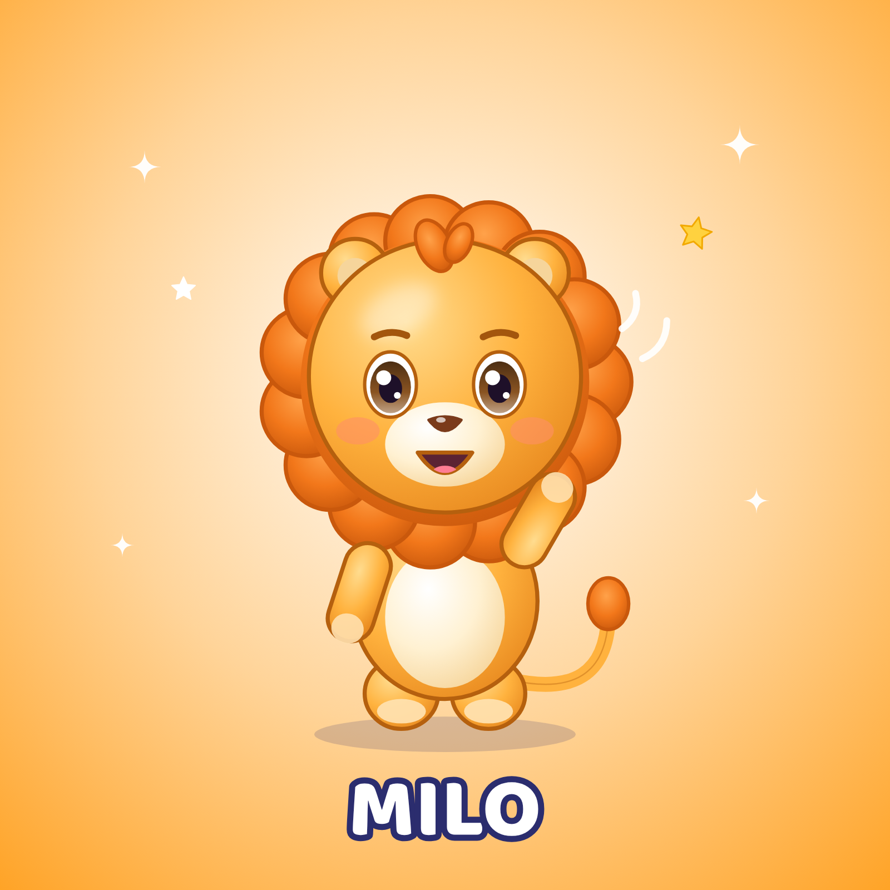

# Milo — petit lion · Fiche d'identité officielle

## Identité
| | |
|---|---|
| Nom | **Milo** |
| Espèce | petit lion |
| Âge (ressenti) | Équivalent 4 ans |
| Rôle | Personnage principal et mascotte. Ouvre et ferme la plupart des vidéos, présente les chansons. |
| Personnalité | Courageux, drôle, enthousiaste, protecteur. Toujours le premier à essayer quelque chose de nouveau ; rassure les autres quand ils ont peur. |
| Petit défaut attachant | Un peu impatient : il veut tout faire tout de suite (ressort comique). |
| Aime | Le soleil, sauter, les fraises, faire rire ses copains. |
| Réplique signature | « Coucou les copains ! » / « Grrr… hop ! » |
| Pas de danse signature | Le saut du lion (s'accroupir, « grrr », sauter bras en l'air) |
| Voix | Voix d'enfant (garçon) pétillante, aiguë mais pas criarde, rire franc. Chant juste, énergique. |
| Façon de bouger | Bondissant, rebonds généreux, crinière qui suit le mouvement avec un léger retard. |

## Proportions (verrouillées)
- Hauteur totale = **1 unité** ; tête = **55 %** de la hauteur (style « chibi »), corps = 30 %, jambes = 15 %.
- Yeux grands, écartés, placés juste sous le milieu de la tête ; deux reflets blancs (un grand en haut à gauche, un petit en bas à droite).
- Bras courts arrondis (n'atteignent pas le sommet de la tête même levés), pas de doigts visibles : pattes arrondies avec coussinets.
- Contour doux de la couleur « Contour » (jamais noir pur).

## Palette verrouillée
| Élément | Couleur |
|---|---|
| Base fourrure | `#FFB23E` |
| Lumière | `#FFDC8F` |
| Ombre | `#E8891F` |
| Contour | `#B5600E` |
| Ventre / museau | `#FFF1D2` |
| Coussinets / sabots | `#FFE0AE` |
| Yeux (iris) | `#8A5422` |
| Nez | `#7B3B1B` |
| Joues | `#FF8F66` |
| Crinière | `#F2771A` |
| Crinière lumière | `#FFA24A` |
| Crinière ombre | `#C9580C` |

## À ne JAMAIS faire
- Ne jamais le montrer agressif ou effrayant ; son « grrr » est toujours mignon. Pas de dents pointues.
- Changer les couleurs, ajouter des vêtements ou accessoires permanents, modifier la forme des oreilles/yeux, ajouter des doigts.
- Le montrer dans une situation dangereuse, effrayante ou de moquerie.
- Accessoires **temporaires** autorisés quand l'histoire l'exige (chapeau de fête, brosse à dents, pinceau), retirés ensuite.

## Fichiers de référence (dans ce dossier)
| Fichier | Usage |
|---|---|
| `milo_illustration_officielle.png` | Visuel officiel 1600×1600 (réseaux, présentation) |
| `milo_vue_face.png` · `milo_vue_profil.png` · `milo_vue_dos.png` | Vues sur fond blanc = **images de référence à joindre aux IA** |
| `milo_vue_face_transparent.png` | Détourage pour montage/miniatures |
| `milo_planche_rotation.png` | Turnaround face/profil/dos avec repères de proportions |
| `milo_expressions.png` | 8 expressions officielles |
| `milo_poses.png` | 6 poses de référence |
| `milo_fiche_identite.png` | Fiche visuelle avec palette |
| `PROMPT_MAITRE.md` | Prompt de reproduction à utiliser tel quel |
