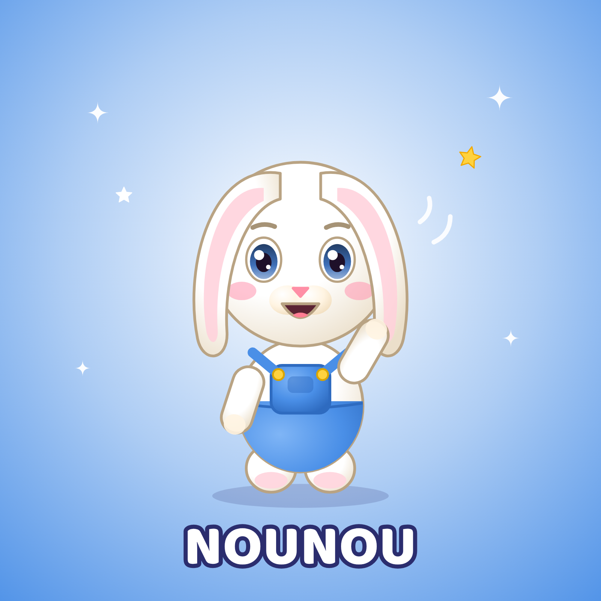

# Nounou — petit lapin · Fiche d'identité officielle

## Identité
| | |
|---|---|
| Nom | **Nounou** |
| Espèce | petit lapin |
| Âge (ressenti) | Équivalent 5 ans (la « grande » de la bande) |
| Rôle | Apprentissage : chiffres, couleurs, formes, lettres, routines (dents, rangement). |
| Personnalité | Calme, intelligente, gentille, attentive. Explique avec patience, félicite toujours. |
| Petit défaut attachant | Un peu perfectionniste : elle aime que tout soit bien rangé (et finit par en rire). |
| Aime | Compter, ranger, les carottes, apprendre de nouvelles choses. |
| Réplique signature | « Bravo, tu as réussi ! » |
| Pas de danse signature | Les oreilles qui volent (battre des bras, les oreilles se soulèvent) |
| Voix | Voix claire et posée, diction parfaite, ton encourageant (idéale pour les contenus éducatifs). |
| Façon de bouger | Posé, précis, gestes de démonstration lisibles ; oreilles qui ballottent doucement. |

## Proportions (verrouillées)
- Hauteur totale = **1 unité** ; tête = **55 %** de la hauteur (style « chibi »), corps = 30 %, jambes = 15 %.
- Yeux grands, écartés, placés juste sous le milieu de la tête ; deux reflets blancs (un grand en haut à gauche, un petit en bas à droite).
- Bras courts arrondis (n'atteignent pas le sommet de la tête même levés), pas de doigts visibles : pattes arrondies avec coussinets.
- Contour doux de la couleur « Contour » (jamais noir pur).

## Palette verrouillée
| Élément | Couleur |
|---|---|
| Base fourrure | `#FFFFFF` |
| Lumière | `#FFFFFF` |
| Ombre | `#EBDFCA` |
| Contour | `#B9A383` |
| Ventre / museau | `#FFF4E2` |
| Coussinets / sabots | `#FFD6DE` |
| Yeux (iris) | `#3E6FB8` |
| Nez | `#FF8FA6` |
| Joues | `#FF9DB5` |
| Salopette | `#4A8FE7` |
| Boutons | `#FFD23F` |
| Intérieur oreilles | `#FFD0DA` |

## À ne JAMAIS faire
- La salopette bleue à boutons jaunes est permanente : jamais retirée ni changée de couleur.
- Changer les couleurs, ajouter des vêtements ou accessoires permanents, modifier la forme des oreilles/yeux, ajouter des doigts.
- Le montrer dans une situation dangereuse, effrayante ou de moquerie.
- Accessoires **temporaires** autorisés quand l'histoire l'exige (chapeau de fête, brosse à dents, pinceau), retirés ensuite.

## Fichiers de référence (dans ce dossier)
| Fichier | Usage |
|---|---|
| `nounou_illustration_officielle.png` | Visuel officiel 1600×1600 (réseaux, présentation) |
| `nounou_vue_face.png` · `nounou_vue_profil.png` · `nounou_vue_dos.png` | Vues sur fond blanc = **images de référence à joindre aux IA** |
| `nounou_vue_face_transparent.png` | Détourage pour montage/miniatures |
| `nounou_planche_rotation.png` | Turnaround face/profil/dos avec repères de proportions |
| `nounou_expressions.png` | 8 expressions officielles |
| `nounou_poses.png` | 6 poses de référence |
| `nounou_fiche_identite.png` | Fiche visuelle avec palette |
| `PROMPT_MAITRE.md` | Prompt de reproduction à utiliser tel quel |
