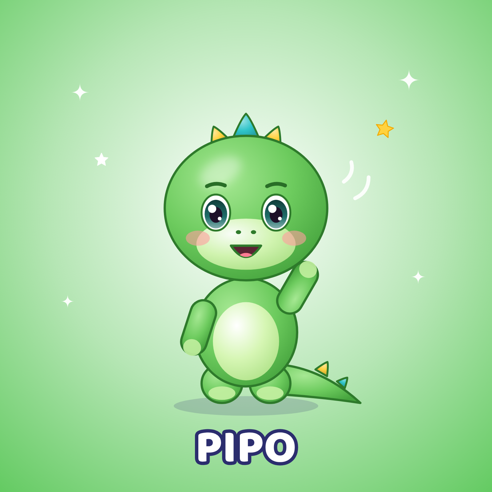

# Pipo — petit dinosaure · Fiche d'identité officielle

## Identité
| | |
|---|---|
| Nom | **Pipo** |
| Espèce | petit dinosaure |
| Âge (ressenti) | Équivalent 4 ans |
| Rôle | Chansons pour apprendre, danser et découvrir (sciences, espace, nature, mouvements). |
| Personnalité | Curieux, énergique, joueur, aventurier. Pose des questions sur tout, entraîne les autres dans ses projets. |
| Petit défaut attachant | Il bouge tout le temps et a du mal à attendre son tour. |
| Aime | Les fusées, les fêtes, explorer, faire « Rooar ! » (tout doux). |
| Réplique signature | « Rooar ! Rigolo ! » / « On y va ? » |
| Pas de danse signature | Le boum du dino (taper des pieds en rythme) |
| Voix | Voix vive, rapide, légèrement aiguë, rire en cascade. |
| Façon de bouger | Vif, nerveux, sautille ; queue qui balance comme un métronome. |

## Proportions (verrouillées)
- Hauteur totale = **1 unité** ; tête = **55 %** de la hauteur (style « chibi »), corps = 30 %, jambes = 15 %.
- Yeux grands, écartés, placés juste sous le milieu de la tête ; deux reflets blancs (un grand en haut à gauche, un petit en bas à droite).
- Bras courts arrondis (n'atteignent pas le sommet de la tête même levés), pas de doigts visibles : pattes arrondies avec coussinets.
- Contour doux de la couleur « Contour » (jamais noir pur).

## Palette verrouillée
| Élément | Couleur |
|---|---|
| Base fourrure | `#6DCB5E` |
| Lumière | `#A6E893` |
| Ombre | `#45A33D` |
| Contour | `#2E7A2B` |
| Ventre / museau | `#D6F6B4` |
| Coussinets / sabots | `#C2EFA0` |
| Yeux (iris) | `#1F6E6A` |
| Nez | `#2E7A2B` |
| Joues | `#FF9E9E` |
| Épines A | `#2EC4C8` |
| Épines B | `#FFD23F` |

## À ne JAMAIS faire
- Jamais effrayant : pas de crocs, pas de griffes, « Rooar » mignon. Épines toujours turquoise/jaune et arrondies.
- Changer les couleurs, ajouter des vêtements ou accessoires permanents, modifier la forme des oreilles/yeux, ajouter des doigts.
- Le montrer dans une situation dangereuse, effrayante ou de moquerie.
- Accessoires **temporaires** autorisés quand l'histoire l'exige (chapeau de fête, brosse à dents, pinceau), retirés ensuite.

## Fichiers de référence (dans ce dossier)
| Fichier | Usage |
|---|---|
| `pipo_illustration_officielle.png` | Visuel officiel 1600×1600 (réseaux, présentation) |
| `pipo_vue_face.png` · `pipo_vue_profil.png` · `pipo_vue_dos.png` | Vues sur fond blanc = **images de référence à joindre aux IA** |
| `pipo_vue_face_transparent.png` | Détourage pour montage/miniatures |
| `pipo_planche_rotation.png` | Turnaround face/profil/dos avec repères de proportions |
| `pipo_expressions.png` | 8 expressions officielles |
| `pipo_poses.png` | 6 poses de référence |
| `pipo_fiche_identite.png` | Fiche visuelle avec palette |
| `PROMPT_MAITRE.md` | Prompt de reproduction à utiliser tel quel |
