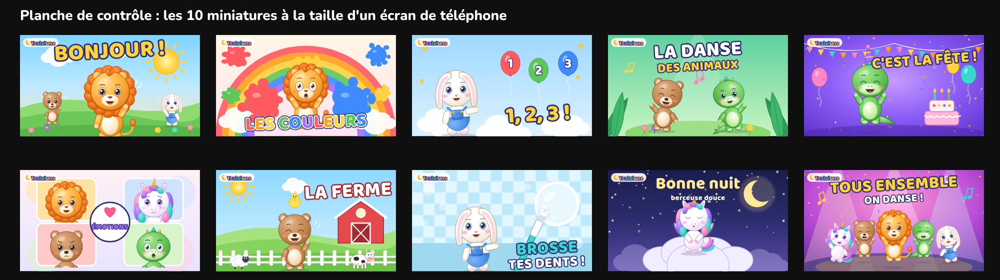

# Système de miniatures Tralalune (1280 × 720)

## Les 10 miniatures créées
| Fichier | Vidéo | Concept visuel (chacun différent) |
|---|---|---|
| `M01_bonjour_les_amis.png` | Bonjour les amis ! | Milo géant fait coucou devant un soleil levant ; Bibou et Nounou en arrière-plan. **Grand personnage + soleil.** |
| `M02_couleurs_avec_milo.png` | Les couleurs | Milo surpris saute au milieu d'éclaboussures de peinture sous un arc-en-ciel ; titre multicolore. **Explosion de couleurs.** |
| `M03_chiffres_1_2_3.png` | Les chiffres | Nounou montre trois ballons numérotés 1-2-3. **Objets numérotés = sujet compris instantanément.** |
| `M04_danse_des_animaux.png` | Danse des animaux | Bibou et Pipo dansent en miroir dans une clairière. **Duo en mouvement.** |
| `M05_pipo_fait_la_fete.png` | La fête de Pipo | Pipo saute avec chapeau de fête, gâteau, confettis sur fond violet. **Fête, fond saturé.** |
| `M06_chanson_des_emotions.png` | Émotions | Grille de 4 visages (joie, tristesse, colère, surprise) autour d'un cœur. **Format grille, unique sur la chaîne.** |
| `M07_ferme_des_copains.png` | La ferme | Bibou rit avec un poussin sur la tête ; vache, mouton, grange rouge. **Animaux reconnaissables.** |
| `M08_brossage_des_dents.png` | Brossage des dents | Nounou montre une brosse à dents géante dans une salle de bain lumineuse. **Objet géant.** |
| `M09_bonne_nuit_luna.png` | Berceuse | Luna endormie sur un nuage, lune et étoiles, couleurs nuit. **Seule miniature sombre et calme = signal « dodo ».** |
| `M10_tous_ensemble_on_danse.png` | Tous ensemble | Les 5 copains sautent sur une scène avec projecteurs. **Toute la bande = vidéo « événement ».** |

## Les 7 règles du système
1. **Repère de marque fixe** : pastille blanche « 🌙 Tralalune » en haut à gauche, toujours au même endroit, même taille → reconnaissance immédiate dans les suggestions.
2. **Un sujet dominant** qui occupe 40 à 60 % de la hauteur, visage tourné vers le spectateur, expression forte (joie, surprise, rire).
3. **2 à 3 mots maximum**, police Baloo 2, contour bleu nuit épais, légère rotation. Le texte complète l'image, il ne répète pas tout le titre.
4. **Contraste** : fond d'une couleur dominante, personnage d'une couleur complémentaire (ex. lion orange sur ciel bleu).
5. **Lisible en 1 seconde à 160 px de large** : vérifier avec la planche de contrôle (taille téléphone).
6. **Chaque thème a son décor** (matin, arc-en-ciel, ciel, jungle, fête, pastel, ferme, salle de bain, nuit, scène) → variété visuelle sans perdre l'unité.
7. **Honnêteté** : la miniature montre ce qui est réellement dans la vidéo (pas de « piège à clics » — c'est aussi une exigence des règles YouTube pour le jeune public).

## Gabarits pour les vidéos suivantes
| Type de vidéo | Gabarit |
|---|---|
| Comptine solo | Personnage principal géant à gauche ou au centre + objet-clé + 2 mots |
| Compilation 20-40 min | Les 5 copains + gros badge « 30 MIN » jaune (coin haut droit) + thème |
| Berceuse / version longue | Fond nuit, personnage endormi, texte jaune doux, aucun élément agressif |
| Éducatif | Personnage qui montre + objets dénombrables/colorés + chiffre ou mot |
| Short | Pas de miniature personnalisable sur mobile : soigner la **première image** (personnage + texte court) |

## Produire une nouvelle miniature
1. Générer l'illustration de fond et les personnages avec les prompts maîtres (`08_PROMPTS/PROMPTS_MAITRES_PERSONNAGES.md`) **ou** utiliser le générateur : ajouter une fonction `@thumb(11)` dans `_outils/generer_visuels.py` puis `python3 _outils/generer_visuels.py miniatures`.
2. Ajouter le titre (Baloo 2) et la pastille de marque.
3. Contrôler la planche à taille réduite.
4. Test A/B : YouTube Studio propose le test de miniatures (« Tester et comparer ») — préparer 2 à 3 variantes pour les vidéos importantes.
