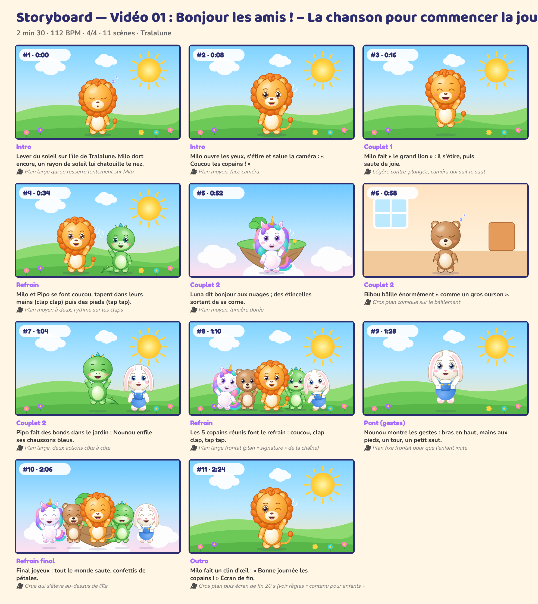

# Storyboard — Vidéo 01 : Bonjour les amis ! – La chanson pour commencer la journée

*Planche générée automatiquement avec les personnages officiels (cadrage et composition de référence). La version finale sera produite avec les prompts de `08_PROMPTS/VIDEO_01_prompts.md`.*

| # | Temps | Partie | Décor | Personnages (pose, expression) | Action | Caméra |
|---|---|---|---|---|---|---|
| 1 | 0:00 | Intro | matin | Milo (debout, endormi) | Lever du soleil sur l'île de Tralalune. Milo dort encore, un rayon de soleil lui chatouille le nez. | Plan large qui se resserre lentement sur Milo |
| 2 | 0:08 | Intro | matin | Milo (coucou, joyeux) | Milo ouvre les yeux, s'étire et salue la caméra : « Coucou les copains ! » | Plan moyen, face caméra |
| 3 | 0:16 | Couplet 1 | matin | Milo (saut, rire) | Milo fait « le grand lion » : il s'étire, puis saute de joie. | Légère contre-plongée, caméra qui suit le saut |
| 4 | 0:34 | Refrain | matin | Milo (coucou, joyeux), Pipo (coucou, joyeux) | Milo et Pipo se font coucou, tapent dans leurs mains (clap clap) puis des pieds (tap tap). | Plan moyen à deux, rythme sur les claps |
| 5 | 0:52 | Couplet 2 | ile | Luna (coucou, joyeux) | Luna dit bonjour aux nuages ; des étincelles sortent de sa corne. | Plan moyen, lumière dorée |
| 6 | 0:58 | Couplet 2 | maison | Bibou (debout, endormi) | Bibou bâille énormément « comme un gros ourson ». | Gros plan comique sur le bâillement |
| 7 | 1:04 | Couplet 2 | matin | Pipo (saut, rire), Nounou (debout, joyeux) | Pipo fait des bonds dans le jardin ; Nounou enfile ses chaussons bleus. | Plan large, deux actions côte à côte |
| 8 | 1:10 | Refrain | matin | Luna (danse, joyeux), Bibou (coucou, joyeux), Milo (coucou, joyeux), Pipo (coucou, joyeux), Nounou (danse, joyeux) | Les 5 copains réunis font le refrain : coucou, clap clap, tap tap. | Plan large frontal (plan « signature » de la chaîne) |
| 9 | 1:28 | Pont (gestes) | matin | Nounou (saut, joyeux) | Nounou montre les gestes : bras en haut, mains aux pieds, un tour, un petit saut. | Plan fixe frontal pour que l'enfant imite |
| 10 | 2:06 | Refrain final | ile | Luna (saut, rire), Bibou (saut, rire), Milo (saut, rire), Pipo (saut, rire), Nounou (saut, rire) | Final joyeux : tout le monde saute, confettis de pétales. | Grue qui s'élève au-dessus de l'île |
| 11 | 2:24 | Outro | matin | Milo (coucou, clin) | Milo fait un clin d'œil : « Bonne journée les copains ! » Écran de fin. | Gros plan puis écran de fin 20 s (voir règles « contenu pour enfants ») |

## Règles de mise en scène (toutes vidéos)
- Plans longs (3 à 8 s) : pas de montage épileptique, rythme calme et lisible pour les 0-6 ans.
- Personnages toujours entièrement lisibles, regard caméra fréquent pour créer le lien.
- Les gestes à imiter sont filmés **de face**, plan entier, fixes.
- Aucun flash, aucun clignotement rapide, aucun bruit soudain fort.
- Le « plan signature » des 5 copains alignés (ordre : Luna, Bibou, Milo, Pipo, Nounou) revient dans chaque vidéo.
