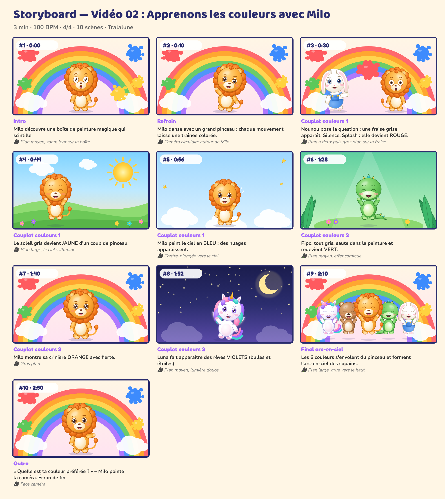

# Storyboard — Vidéo 02 : Apprenons les couleurs avec Milo

*Planche générée automatiquement avec les personnages officiels (cadrage et composition de référence). La version finale sera produite avec les prompts de `08_PROMPTS/VIDEO_02_prompts.md`.*

| # | Temps | Partie | Décor | Personnages (pose, expression) | Action | Caméra |
|---|---|---|---|---|---|---|
| 1 | 0:00 | Intro | couleurs | Milo (debout, surpris) | Milo découvre une boîte de peinture magique qui scintille. | Plan moyen, zoom lent sur la boîte |
| 2 | 0:10 | Refrain | couleurs | Milo (danse, joyeux) | Milo danse avec un grand pinceau ; chaque mouvement laisse une traînée colorée. | Caméra circulaire autour de Milo |
| 3 | 0:30 | Couplet couleurs 1 | couleurs | Nounou (montre, joyeux), Milo (debout, surpris) | Nounou pose la question ; une fraise grise apparaît. Silence. Splash : elle devient ROUGE. | Plan à deux puis gros plan sur la fraise |
| 4 | 0:44 | Couplet couleurs 1 | matin | Milo (saut, rire) | Le soleil gris devient JAUNE d'un coup de pinceau. | Plan large, le ciel s'illumine |
| 5 | 0:56 | Couplet couleurs 1 | chiffres | Milo (coucou, joyeux) | Milo peint le ciel en BLEU ; des nuages apparaissent. | Contre-plongée vers le ciel |
| 6 | 1:28 | Couplet couleurs 2 | jungle | Pipo (saut, rire) | Pipo, tout gris, saute dans la peinture et redevient VERT. | Plan moyen, effet comique |
| 7 | 1:40 | Couplet couleurs 2 | couleurs | Milo (debout, joyeux) | Milo montre sa crinière ORANGE avec fierté. | Gros plan |
| 8 | 1:52 | Couplet couleurs 2 | nuit | Luna (danse, joyeux) | Luna fait apparaître des rêves VIOLETS (bulles et étoiles). | Plan moyen, lumière douce |
| 9 | 2:10 | Final arc-en-ciel | couleurs | Luna (saut, rire), Bibou (saut, rire), Milo (saut, rire), Pipo (saut, rire), Nounou (saut, rire) | Les 6 couleurs s'envolent du pinceau et forment l'arc-en-ciel des copains. | Plan large, grue vers le haut |
| 10 | 2:50 | Outro | couleurs | Milo (montre, joyeux) | « Quelle est ta couleur préférée ? » – Milo pointe la caméra. Écran de fin. | Face caméra |

## Règles de mise en scène (toutes vidéos)
- Plans longs (3 à 8 s) : pas de montage épileptique, rythme calme et lisible pour les 0-6 ans.
- Personnages toujours entièrement lisibles, regard caméra fréquent pour créer le lien.
- Les gestes à imiter sont filmés **de face**, plan entier, fixes.
- Aucun flash, aucun clignotement rapide, aucun bruit soudain fort.
- Le « plan signature » des 5 copains alignés (ordre : Luna, Bibou, Milo, Pipo, Nounou) revient dans chaque vidéo.
