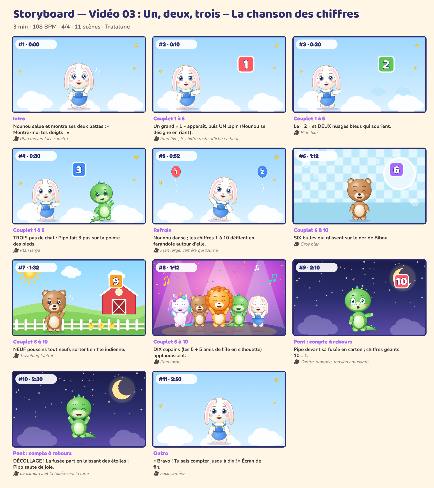

# Storyboard — Vidéo 03 : Un, deux, trois – La chanson des chiffres

*Planche générée automatiquement avec les personnages officiels (cadrage et composition de référence). La version finale sera produite avec les prompts de `08_PROMPTS/VIDEO_03_prompts.md`.*

| # | Temps | Partie | Décor | Personnages (pose, expression) | Action | Caméra |
|---|---|---|---|---|---|---|
| 1 | 0:00 | Intro | chiffres | Nounou (coucou, joyeux) | Nounou salue et montre ses deux pattes : « Montre-moi tes doigts ! » | Plan moyen face caméra |
| 2 | 0:10 | Couplet 1 à 5 | chiffres | Nounou (montre, joyeux) | Un grand « 1 » apparaît, puis UN lapin (Nounou se désigne en riant). | Plan fixe ; le chiffre reste affiché en haut |
| 3 | 0:20 | Couplet 1 à 5 | chiffres | Nounou (montre, joyeux) | Le « 2 » et DEUX nuages bleus qui sourient. | Plan fixe |
| 4 | 0:30 | Couplet 1 à 5 | chiffres | Pipo (danse, joyeux), Nounou (montre, joyeux) | TROIS pas de chat : Pipo fait 3 pas sur la pointe des pieds. | Plan large |
| 5 | 0:52 | Refrain | chiffres | Nounou (danse, joyeux) | Nounou danse ; les chiffres 1 à 10 défilent en farandole autour d'elle. | Plan large, caméra qui tourne |
| 6 | 1:12 | Couplet 6 à 10 | salle_de_bain | Bibou (debout, rire) | SIX bulles qui glissent sur le nez de Bibou. | Gros plan |
| 7 | 1:32 | Couplet 6 à 10 | ferme | Bibou (coucou, joyeux) | NEUF poussins tout neufs sortent en file indienne. | Travelling latéral |
| 8 | 1:42 | Couplet 6 à 10 | scene | Luna (saut, rire), Bibou (saut, rire), Milo (saut, rire), Pipo (saut, rire), Nounou (saut, rire) | DIX copains (les 5 + 5 amis de l'île en silhouette) applaudissent. | Plan large |
| 9 | 2:10 | Pont : compte à rebours | nuit | Pipo (montre, surpris) | Pipo devant sa fusée en carton ; chiffres géants 10→1. | Contre-plongée, tension amusante |
| 10 | 2:30 | Pont : compte à rebours | nuit | Pipo (saut, rire) | DÉCOLLAGE ! La fusée part en laissant des étoiles ; Pipo saute de joie. | La caméra suit la fusée vers la lune |
| 11 | 2:50 | Outro | chiffres | Nounou (debout, joyeux) | « Bravo ! Tu sais compter jusqu'à dix ! » Écran de fin. | Face caméra |

## Règles de mise en scène (toutes vidéos)
- Plans longs (3 à 8 s) : pas de montage épileptique, rythme calme et lisible pour les 0-6 ans.
- Personnages toujours entièrement lisibles, regard caméra fréquent pour créer le lien.
- Les gestes à imiter sont filmés **de face**, plan entier, fixes.
- Aucun flash, aucun clignotement rapide, aucun bruit soudain fort.
- Le « plan signature » des 5 copains alignés (ordre : Luna, Bibou, Milo, Pipo, Nounou) revient dans chaque vidéo.
