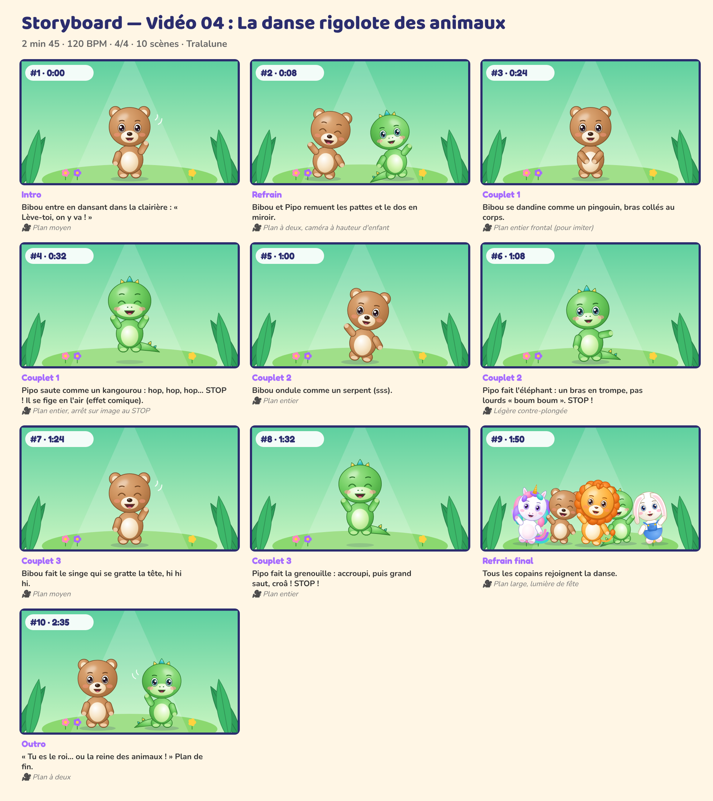

# Storyboard — Vidéo 04 : La danse rigolote des animaux

*Planche générée automatiquement avec les personnages officiels (cadrage et composition de référence). La version finale sera produite avec les prompts de `08_PROMPTS/VIDEO_04_prompts.md`.*

| # | Temps | Partie | Décor | Personnages (pose, expression) | Action | Caméra |
|---|---|---|---|---|---|---|
| 1 | 0:00 | Intro | jungle | Bibou (coucou, joyeux) | Bibou entre en dansant dans la clairière : « Lève-toi, on y va ! » | Plan moyen |
| 2 | 0:08 | Refrain | jungle | Bibou (danse, rire), Pipo (danse, joyeux) | Bibou et Pipo remuent les pattes et le dos en miroir. | Plan à deux, caméra à hauteur d'enfant |
| 3 | 0:24 | Couplet 1 | jungle | Bibou (calin, joyeux) | Bibou se dandine comme un pingouin, bras collés au corps. | Plan entier frontal (pour imiter) |
| 4 | 0:32 | Couplet 1 | jungle | Pipo (saut, rire) | Pipo saute comme un kangourou : hop, hop, hop… STOP ! Il se fige en l'air (effet comique). | Plan entier, arrêt sur image au STOP |
| 5 | 1:00 | Couplet 2 | jungle | Bibou (danse, joyeux) | Bibou ondule comme un serpent (sss). | Plan entier |
| 6 | 1:08 | Couplet 2 | jungle | Pipo (montre, joyeux) | Pipo fait l'éléphant : un bras en trompe, pas lourds « boum boum ». STOP ! | Légère contre-plongée |
| 7 | 1:24 | Couplet 3 | jungle | Bibou (coucou, rire) | Bibou fait le singe qui se gratte la tête, hi hi hi. | Plan moyen |
| 8 | 1:32 | Couplet 3 | jungle | Pipo (saut, rire) | Pipo fait la grenouille : accroupi, puis grand saut, croâ ! STOP ! | Plan entier |
| 9 | 1:50 | Refrain final | jungle | Luna (danse, joyeux), Bibou (danse, rire), Milo (danse, joyeux), Pipo (danse, rire), Nounou (danse, joyeux) | Tous les copains rejoignent la danse. | Plan large, lumière de fête |
| 10 | 2:35 | Outro | jungle | Bibou (debout, joyeux), Pipo (coucou, joyeux) | « Tu es le roi… ou la reine des animaux ! » Plan de fin. | Plan à deux |

## Règles de mise en scène (toutes vidéos)
- Plans longs (3 à 8 s) : pas de montage épileptique, rythme calme et lisible pour les 0-6 ans.
- Personnages toujours entièrement lisibles, regard caméra fréquent pour créer le lien.
- Les gestes à imiter sont filmés **de face**, plan entier, fixes.
- Aucun flash, aucun clignotement rapide, aucun bruit soudain fort.
- Le « plan signature » des 5 copains alignés (ordre : Luna, Bibou, Milo, Pipo, Nounou) revient dans chaque vidéo.
