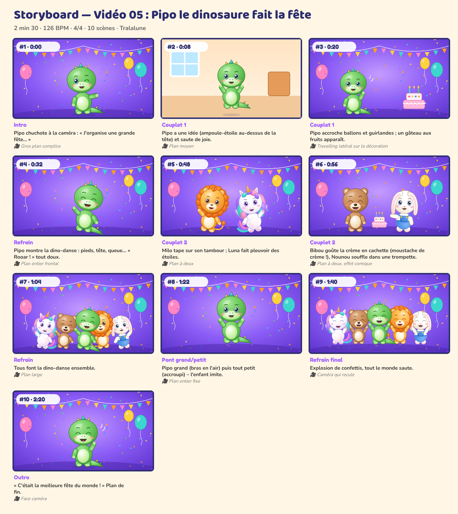

# Storyboard — Vidéo 05 : Pipo le dinosaure fait la fête

*Planche générée automatiquement avec les personnages officiels (cadrage et composition de référence). La version finale sera produite avec les prompts de `08_PROMPTS/VIDEO_05_prompts.md`.*

| # | Temps | Partie | Décor | Personnages (pose, expression) | Action | Caméra |
|---|---|---|---|---|---|---|
| 1 | 0:00 | Intro | fete | Pipo (montre, clin) | Pipo chuchote à la caméra : « J'organise une grande fête… » | Gros plan complice |
| 2 | 0:08 | Couplet 1 | maison | Pipo (saut, joyeux) | Pipo a une idée (ampoule-étoile au-dessus de la tête) et saute de joie. | Plan moyen |
| 3 | 0:20 | Couplet 1 | fete | Pipo (coucou, joyeux) | Pipo accroche ballons et guirlandes ; un gâteau aux fruits apparaît. | Travelling latéral sur la décoration |
| 4 | 0:32 | Refrain | fete | Pipo (danse, rire) | Pipo montre la dino-danse : pieds, tête, queue… « Rooar ! » tout doux. | Plan entier frontal |
| 5 | 0:48 | Couplet 2 | fete | Milo (danse, joyeux), Luna (danse, joyeux) | Milo tape sur son tambour ; Luna fait pleuvoir des étoiles. | Plan à deux |
| 6 | 0:56 | Couplet 2 | fete | Bibou (debout, rire), Nounou (montre, joyeux) | Bibou goûte la crème en cachette (moustache de crème !), Nounou souffle dans une trompette. | Plan à deux, effet comique |
| 7 | 1:04 | Refrain | fete | Luna (danse, joyeux), Bibou (danse, rire), Pipo (danse, rire), Milo (danse, joyeux), Nounou (danse, joyeux) | Tous font la dino-danse ensemble. | Plan large |
| 8 | 1:22 | Pont grand/petit | fete | Pipo (saut, joyeux) | Pipo grand (bras en l'air) puis tout petit (accroupi) – l'enfant imite. | Plan entier fixe |
| 9 | 1:40 | Refrain final | fete | Luna (saut, rire), Bibou (saut, rire), Pipo (saut, rire), Milo (saut, rire), Nounou (saut, rire) | Explosion de confettis, tout le monde saute. | Caméra qui recule |
| 10 | 2:20 | Outro | fete | Pipo (coucou, rire) | « C'était la meilleure fête du monde ! » Plan de fin. | Face caméra |

## Règles de mise en scène (toutes vidéos)
- Plans longs (3 à 8 s) : pas de montage épileptique, rythme calme et lisible pour les 0-6 ans.
- Personnages toujours entièrement lisibles, regard caméra fréquent pour créer le lien.
- Les gestes à imiter sont filmés **de face**, plan entier, fixes.
- Aucun flash, aucun clignotement rapide, aucun bruit soudain fort.
- Le « plan signature » des 5 copains alignés (ordre : Luna, Bibou, Milo, Pipo, Nounou) revient dans chaque vidéo.
