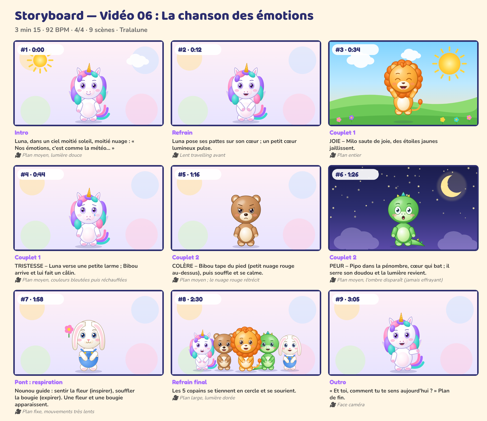

# Storyboard — Vidéo 06 : La chanson des émotions

*Planche générée automatiquement avec les personnages officiels (cadrage et composition de référence). La version finale sera produite avec les prompts de `08_PROMPTS/VIDEO_06_prompts.md`.*

| # | Temps | Partie | Décor | Personnages (pose, expression) | Action | Caméra |
|---|---|---|---|---|---|---|
| 1 | 0:00 | Intro | emotions | Luna (debout, neutre) | Luna, dans un ciel moitié soleil, moitié nuage : « Nos émotions, c'est comme la météo… » | Plan moyen, lumière douce |
| 2 | 0:12 | Refrain | emotions | Luna (calin, joyeux) | Luna pose ses pattes sur son cœur ; un petit cœur lumineux pulse. | Lent travelling avant |
| 3 | 0:34 | Couplet 1 | matin | Milo (saut, rire) | JOIE – Milo saute de joie, des étoiles jaunes jaillissent. | Plan entier |
| 4 | 0:44 | Couplet 1 | emotions | Luna (debout, triste) | TRISTESSE – Luna verse une petite larme ; Bibou arrive et lui fait un câlin. | Plan moyen, couleurs bleutées puis réchauffées |
| 5 | 1:16 | Couplet 2 | emotions | Bibou (debout, fache) | COLÈRE – Bibou tape du pied (petit nuage rouge au-dessus), puis souffle et se calme. | Plan moyen ; le nuage rouge rétrécit |
| 6 | 1:26 | Couplet 2 | nuit | Pipo (debout, surpris) | PEUR – Pipo dans la pénombre, cœur qui bat ; il serre son doudou et la lumière revient. | Plan moyen, l'ombre disparaît (jamais effrayant) |
| 7 | 1:58 | Pont : respiration | emotions | Nounou (calin, neutre) | Nounou guide : sentir la fleur (inspirer), souffler la bougie (expirer). Une fleur et une bougie apparaissent. | Plan fixe, mouvements très lents |
| 8 | 2:30 | Refrain final | emotions | Luna (calin, joyeux), Bibou (calin, joyeux), Milo (calin, joyeux), Pipo (calin, joyeux), Nounou (calin, joyeux) | Les 5 copains se tiennent en cercle et se sourient. | Plan large, lumière dorée |
| 9 | 3:05 | Outro | emotions | Luna (montre, joyeux) | « Et toi, comment tu te sens aujourd'hui ? » Plan de fin. | Face caméra |

## Règles de mise en scène (toutes vidéos)
- Plans longs (3 à 8 s) : pas de montage épileptique, rythme calme et lisible pour les 0-6 ans.
- Personnages toujours entièrement lisibles, regard caméra fréquent pour créer le lien.
- Les gestes à imiter sont filmés **de face**, plan entier, fixes.
- Aucun flash, aucun clignotement rapide, aucun bruit soudain fort.
- Le « plan signature » des 5 copains alignés (ordre : Luna, Bibou, Milo, Pipo, Nounou) revient dans chaque vidéo.
