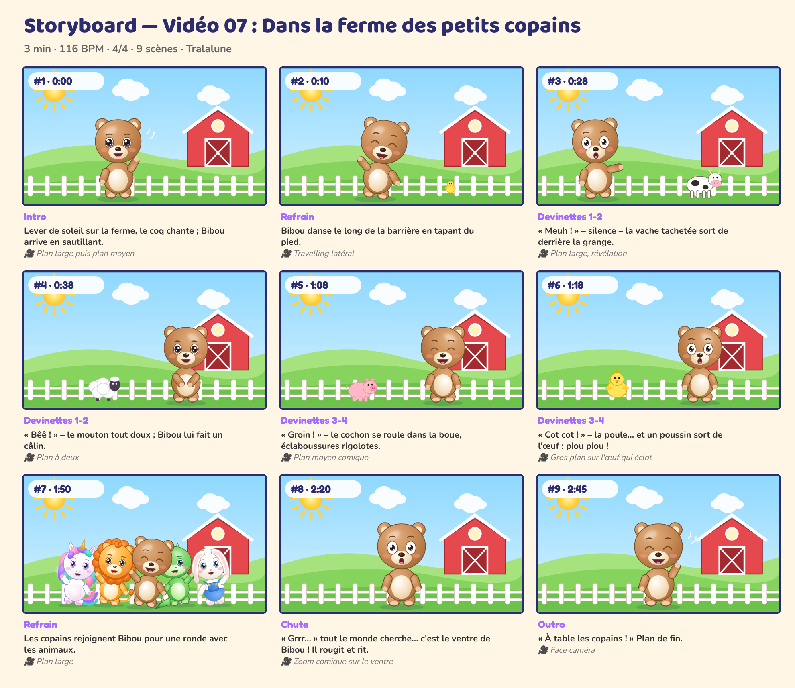

# Storyboard — Vidéo 07 : Dans la ferme des petits copains

*Planche générée automatiquement avec les personnages officiels (cadrage et composition de référence). La version finale sera produite avec les prompts de `08_PROMPTS/VIDEO_07_prompts.md`.*

| # | Temps | Partie | Décor | Personnages (pose, expression) | Action | Caméra |
|---|---|---|---|---|---|---|
| 1 | 0:00 | Intro | ferme | Bibou (coucou, joyeux) | Lever de soleil sur la ferme, le coq chante ; Bibou arrive en sautillant. | Plan large puis plan moyen |
| 2 | 0:10 | Refrain | ferme | Bibou (danse, rire) | Bibou danse le long de la barrière en tapant du pied. | Travelling latéral |
| 3 | 0:28 | Devinettes 1-2 | ferme | Bibou (montre, surpris) | « Meuh ! » – silence – la vache tachetée sort de derrière la grange. | Plan large, révélation |
| 4 | 0:38 | Devinettes 1-2 | ferme | Bibou (calin, joyeux) | « Bêê ! » – le mouton tout doux ; Bibou lui fait un câlin. | Plan à deux |
| 5 | 1:08 | Devinettes 3-4 | ferme | Bibou (debout, rire) | « Groin ! » – le cochon se roule dans la boue, éclaboussures rigolotes. | Plan moyen comique |
| 6 | 1:18 | Devinettes 3-4 | ferme | Bibou (debout, surpris) | « Cot cot ! » – la poule… et un poussin sort de l'œuf : piou piou ! | Gros plan sur l'œuf qui éclot |
| 7 | 1:50 | Refrain | ferme | Luna (danse, joyeux), Milo (danse, joyeux), Bibou (danse, rire), Pipo (danse, joyeux), Nounou (danse, joyeux) | Les copains rejoignent Bibou pour une ronde avec les animaux. | Plan large |
| 8 | 2:20 | Chute | ferme | Bibou (debout, surpris) | « Grrr… » tout le monde cherche… c'est le ventre de Bibou ! Il rougit et rit. | Zoom comique sur le ventre |
| 9 | 2:45 | Outro | ferme | Bibou (coucou, rire) | « À table les copains ! » Plan de fin. | Face caméra |

## Règles de mise en scène (toutes vidéos)
- Plans longs (3 à 8 s) : pas de montage épileptique, rythme calme et lisible pour les 0-6 ans.
- Personnages toujours entièrement lisibles, regard caméra fréquent pour créer le lien.
- Les gestes à imiter sont filmés **de face**, plan entier, fixes.
- Aucun flash, aucun clignotement rapide, aucun bruit soudain fort.
- Le « plan signature » des 5 copains alignés (ordre : Luna, Bibou, Milo, Pipo, Nounou) revient dans chaque vidéo.
