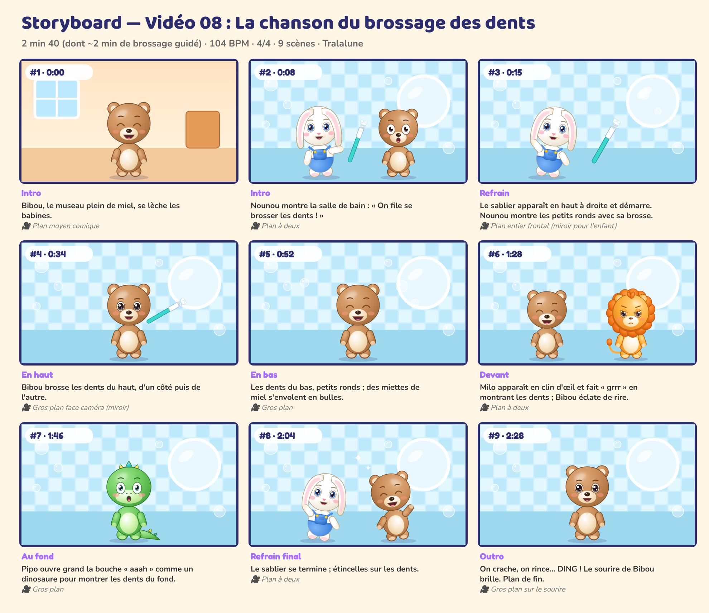

# Storyboard — Vidéo 08 : La chanson du brossage des dents

*Planche générée automatiquement avec les personnages officiels (cadrage et composition de référence). La version finale sera produite avec les prompts de `08_PROMPTS/VIDEO_08_prompts.md`.*

| # | Temps | Partie | Décor | Personnages (pose, expression) | Action | Caméra |
|---|---|---|---|---|---|---|
| 1 | 0:00 | Intro | maison | Bibou (debout, rire) | Bibou, le museau plein de miel, se lèche les babines. | Plan moyen comique |
| 2 | 0:08 | Intro | salle_de_bain | Nounou (montre, joyeux), Bibou (debout, surpris) | Nounou montre la salle de bain : « On file se brosser les dents ! » | Plan à deux |
| 3 | 0:15 | Refrain | salle_de_bain | Nounou (danse, joyeux) | Le sablier apparaît en haut à droite et démarre. Nounou montre les petits ronds avec sa brosse. | Plan entier frontal (miroir pour l'enfant) |
| 4 | 0:34 | En haut | salle_de_bain | Bibou (debout, joyeux) | Bibou brosse les dents du haut, d'un côté puis de l'autre. | Gros plan face caméra (miroir) |
| 5 | 0:52 | En bas | salle_de_bain | Bibou (debout, rire) | Les dents du bas, petits ronds ; des miettes de miel s'envolent en bulles. | Gros plan |
| 6 | 1:28 | Devant | salle_de_bain | Milo (debout, fache), Bibou (debout, rire) | Milo apparaît en clin d'œil et fait « grrr » en montrant les dents ; Bibou éclate de rire. | Plan à deux |
| 7 | 1:46 | Au fond | salle_de_bain | Pipo (debout, surpris) | Pipo ouvre grand la bouche « aaah » comme un dinosaure pour montrer les dents du fond. | Gros plan |
| 8 | 2:04 | Refrain final | salle_de_bain | Nounou (danse, joyeux), Bibou (danse, rire) | Le sablier se termine ; étincelles sur les dents. | Plan à deux |
| 9 | 2:28 | Outro | salle_de_bain | Bibou (debout, joyeux) | On crache, on rince… DING ! Le sourire de Bibou brille. Plan de fin. | Gros plan sur le sourire |

## Règles de mise en scène (toutes vidéos)
- Plans longs (3 à 8 s) : pas de montage épileptique, rythme calme et lisible pour les 0-6 ans.
- Personnages toujours entièrement lisibles, regard caméra fréquent pour créer le lien.
- Les gestes à imiter sont filmés **de face**, plan entier, fixes.
- Aucun flash, aucun clignotement rapide, aucun bruit soudain fort.
- Le « plan signature » des 5 copains alignés (ordre : Luna, Bibou, Milo, Pipo, Nounou) revient dans chaque vidéo.
