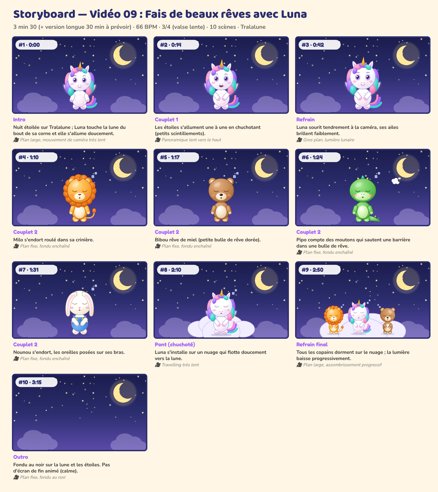

# Storyboard — Vidéo 09 : Fais de beaux rêves avec Luna

*Planche générée automatiquement avec les personnages officiels (cadrage et composition de référence). La version finale sera produite avec les prompts de `08_PROMPTS/VIDEO_09_prompts.md`.*

| # | Temps | Partie | Décor | Personnages (pose, expression) | Action | Caméra |
|---|---|---|---|---|---|---|
| 1 | 0:00 | Intro | nuit | Luna (debout, neutre) | Nuit étoilée sur Tralalune ; Luna touche la lune du bout de sa corne et elle s'allume doucement. | Plan large, mouvement de caméra très lent |
| 2 | 0:14 | Couplet 1 | nuit | Luna (calin, joyeux) | Les étoiles s'allument une à une en chuchotant (petits scintillements). | Panoramique lent vers le haut |
| 3 | 0:42 | Refrain | nuit | Luna (calin, neutre) | Luna sourit tendrement à la caméra, ses ailes brillent faiblement. | Gros plan, lumière lunaire |
| 4 | 1:10 | Couplet 2 | nuit | Milo (debout, endormi) | Milo s'endort roulé dans sa crinière. | Plan fixe, fondu enchaîné |
| 5 | 1:17 | Couplet 2 | nuit | Bibou (debout, endormi) | Bibou rêve de miel (petite bulle de rêve dorée). | Plan fixe, fondu enchaîné |
| 6 | 1:24 | Couplet 2 | nuit | Pipo (debout, endormi) | Pipo compte des moutons qui sautent une barrière dans une bulle de rêve. | Plan fixe, fondu enchaîné |
| 7 | 1:31 | Couplet 2 | nuit | Nounou (calin, endormi) | Nounou s'endort, les oreilles posées sur ses bras. | Plan fixe, fondu enchaîné |
| 8 | 2:10 | Pont (chuchoté) | nuit | Luna (calin, endormi) | Luna s'installe sur un nuage qui flotte doucement vers la lune. | Travelling très lent |
| 9 | 2:50 | Refrain final | nuit | Luna (calin, endormi), Milo (calin, endormi), Bibou (calin, endormi) | Tous les copains dorment sur le nuage ; la lumière baisse progressivement. | Plan large, assombrissement progressif |
| 10 | 3:15 | Outro | nuit | — | Fondu au noir sur la lune et les étoiles. Pas d'écran de fin animé (calme). | Plan fixe, fondu au noir |

## Règles de mise en scène (toutes vidéos)
- Plans longs (3 à 8 s) : pas de montage épileptique, rythme calme et lisible pour les 0-6 ans.
- Personnages toujours entièrement lisibles, regard caméra fréquent pour créer le lien.
- Les gestes à imiter sont filmés **de face**, plan entier, fixes.
- Aucun flash, aucun clignotement rapide, aucun bruit soudain fort.
- Le « plan signature » des 5 copains alignés (ordre : Luna, Bibou, Milo, Pipo, Nounou) revient dans chaque vidéo.
