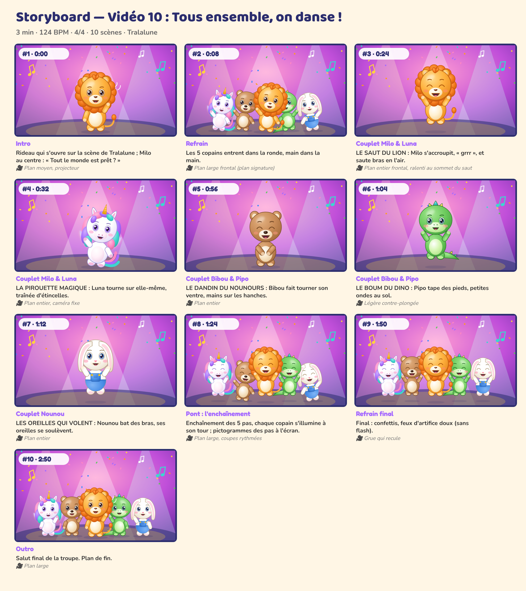

# Storyboard — Vidéo 10 : Tous ensemble, on danse !

*Planche générée automatiquement avec les personnages officiels (cadrage et composition de référence). La version finale sera produite avec les prompts de `08_PROMPTS/VIDEO_10_prompts.md`.*

| # | Temps | Partie | Décor | Personnages (pose, expression) | Action | Caméra |
|---|---|---|---|---|---|---|
| 1 | 0:00 | Intro | scene | Milo (coucou, joyeux) | Rideau qui s'ouvre sur la scène de Tralalune ; Milo au centre : « Tout le monde est prêt ? » | Plan moyen, projecteur |
| 2 | 0:08 | Refrain | scene | Luna (danse, joyeux), Bibou (danse, joyeux), Milo (danse, joyeux), Pipo (danse, joyeux), Nounou (danse, joyeux) | Les 5 copains entrent dans la ronde, main dans la main. | Plan large frontal (plan signature) |
| 3 | 0:24 | Couplet Milo & Luna | scene | Milo (saut, rire) | LE SAUT DU LION : Milo s'accroupit, « grrr », et saute bras en l'air. | Plan entier frontal, ralenti au sommet du saut |
| 4 | 0:32 | Couplet Milo & Luna | scene | Luna (danse, joyeux) | LA PIROUETTE MAGIQUE : Luna tourne sur elle-même, traînée d'étincelles. | Plan entier, caméra fixe |
| 5 | 0:56 | Couplet Bibou & Pipo | scene | Bibou (calin, rire) | LE DANDIN DU NOUNOURS : Bibou fait tourner son ventre, mains sur les hanches. | Plan entier |
| 6 | 1:04 | Couplet Bibou & Pipo | scene | Pipo (saut, joyeux) | LE BOUM DU DINO : Pipo tape des pieds, petites ondes au sol. | Légère contre-plongée |
| 7 | 1:12 | Couplet Nounou | scene | Nounou (saut, joyeux) | LES OREILLES QUI VOLENT : Nounou bat des bras, ses oreilles se soulèvent. | Plan entier |
| 8 | 1:24 | Pont : l'enchaînement | scene | Luna (saut, rire), Bibou (danse, rire), Milo (saut, rire), Pipo (saut, rire), Nounou (danse, rire) | Enchaînement des 5 pas, chaque copain s'illumine à son tour ; pictogrammes des pas à l'écran. | Plan large, coupes rythmées |
| 9 | 1:50 | Refrain final | scene | Luna (saut, rire), Bibou (saut, rire), Milo (saut, rire), Pipo (saut, rire), Nounou (saut, rire) | Final : confettis, feux d'artifice doux (sans flash). | Grue qui recule |
| 10 | 2:50 | Outro | scene | Luna (coucou, joyeux), Bibou (coucou, joyeux), Milo (coucou, joyeux), Pipo (coucou, joyeux), Nounou (coucou, joyeux) | Salut final de la troupe. Plan de fin. | Plan large |

## Règles de mise en scène (toutes vidéos)
- Plans longs (3 à 8 s) : pas de montage épileptique, rythme calme et lisible pour les 0-6 ans.
- Personnages toujours entièrement lisibles, regard caméra fréquent pour créer le lien.
- Les gestes à imiter sont filmés **de face**, plan entier, fixes.
- Aucun flash, aucun clignotement rapide, aucun bruit soudain fort.
- Le « plan signature » des 5 copains alignés (ordre : Luna, Bibou, Milo, Pipo, Nounou) revient dans chaque vidéo.
