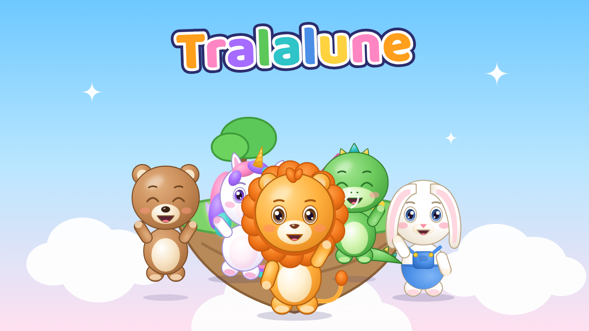

# 🌙 Tralalune — Comptines pour enfants (projet de chaîne YouTube)

> **Nom retenu :** *Tralalune* (nom provisoire initial : « Les P'tits Copains » — voir l'étude des 10 noms)
> **Slogan :** « Chante, danse et rêve avec les copains ! »
> **Public :** enfants de 0 à 6 ans et leurs parents · **Langue :** français · **Personnages :** Milo, Luna, Bibou, Pipo, Nounou

## Ce que contient ce dossier
| Livrable demandé | Où le trouver | État |
|---|---|---|
| Nom de chaîne (étude de 10 noms), slogan, histoire de l'univers, présentation, identité de marque | `01_IDENTITE/NOM_ET_IDENTITE_DE_MARQUE.md` | ✅ |
| Logo officiel, version transparente, version simplifiée, monogramme | `01_IDENTITE/logo/` | ✅ PNG |
| Photo de profil 800×800 + test de lisibilité en petit | `01_IDENTITE/photo_profil/` | ✅ |
| Filigrane de chaîne 150×150 (PNG transparent) | `01_IDENTITE/filigrane/` | ✅ |
| Bannière 2560×1440 + guide des zones de sécurité | `01_IDENTITE/banniere/` | ✅ |
| Palette, typographies (polices incluses), charte graphique (MD + PDF 8 pages) | `01_IDENTITE/charte_graphique/` | ✅ |
| 5 personnages : illustration officielle, vues face/profil/dos, planche de rotation, 8 expressions, 6 poses, fiche visuelle, fiche d'identité, prompt maître | `02_PERSONNAGES/<NOM>/` | ✅ |
| Image de groupe + line-up à l'échelle + bible des personnages | `02_PERSONNAGES/` | ✅ |
| 10 miniatures 1280×720 + système de miniatures + planche de contrôle | `03_MINIATURES/` | ✅ |
| 10 fiches vidéo complètes (titre, structure, tempo, instruments, durée, description, tags, scènes, voix, checklist) | `04_VIDEOS/VIDEO_XX/FICHE_VIDEO.md` | ✅ |
| 10 animatiques MP4 (storyboard minuté + paroles karaoké + maquette sonore) | `04_VIDEOS/VIDEO_XX/animatique_VIDEO_XX.mp4` | ✅ |
| Prompts musique + maquettes mélodiques des refrains (MIDI + MP3) | `05_MUSIQUES/` | ✅ |
| Paroles 100 % originales (lecture + version balisée pour IA musicale) | `06_PAROLES/` | ✅ |
| Storyboards illustrés (PNG) + tableaux de scènes | `07_STORYBOARDS/` | ✅ |
| Prompts image & animation de chaque scène, prompts maîtres, workflow de production et licences des outils | `08_PROMPTS/` | ✅ |
| Textes de chaîne, mots-clés parents, hashtags, playlists, modèles SEO, SEO des 10 vidéos | `09_SEO/` | ✅ |
| Plan de lancement 90 jours + calendrier jour par jour (CSV) | `10_PLANNING/` | ✅ |
| Stratégie de monétisation, règles, risques, droits, 3 scénarios hypothétiques | `11_MONETISATION/` | ✅ |
| Tableau de bord Excel (vidéos, suivi mensuel, objectifs YPP, calendrier, coûts, simulateur) | `12_STATISTIQUES/` | ✅ |
| Outils pour tout régénérer / produire (dessin, storyboards, karaoké, animatiques, tableau) | `_outils/` | ✅ |

## À savoir avant de commencer (transparence)
- **Les visuels livrés sont des illustrations vectorielles originales** (style cartoon à volume doux) réalisées dans cet environnement. Ils fixent le design exact des personnages et servent d'**images de référence** pour produire la version **3D** finale avec des outils d'IA ou Blender. Aucun outil de rendu 3D, de musique chantée ou de vidéo IA n'était accessible ici (abonnements/API nécessaires) : tout est préparé pour que vous les produisiez facilement (`08_PROMPTS/WORKFLOW_PRODUCTION.md`).
- **Les maquettes audio** sont des guides mélodiques synthétisés (boîte à musique + accords), pas les chansons finales.
- **Aucune statistique n'est inventée.** Les chiffres financiers sont des hypothèses explicitement signalées.
- **Le nom « Tralalune »** n'a fait l'objet que d'une recherche web rapide : vérifiez INPI/EUIPO et l'identifiant YouTube avant de vous engager.
- Les créations ont été réalisées avec un assistant IA : appropriez-vous-les (retouches, choix créatifs) et lisez la section droits d'auteur de `11_MONETISATION/STRATEGIE_MONETISATION.md`.

## Par où commencer (ordre conseillé)
1. Lire `01_IDENTITE/NOM_ET_IDENTITE_DE_MARQUE.md`, valider le nom et faire les vérifications juridiques.
2. Parcourir `02_PERSONNAGES/BIBLE_PERSONNAGES.md` et les planches de chaque personnage.
3. Créer la chaîne YouTube avec les fichiers de `01_IDENTITE/` et les textes de `09_SEO/TEXTES_CHAINE_YOUTUBE.md`.
4. Lire `08_PROMPTS/WORKFLOW_PRODUCTION.md`, souscrire aux outils (offres à licence commerciale), fixer les voix.
5. Produire la vidéo 1 : `04_VIDEOS/VIDEO_01/FICHE_VIDEO.md` → regarder l'animatique → musique → images → animation → montage.
6. Suivre `10_PLANNING/PLAN_90_JOURS.md` et remplir chaque semaine `12_STATISTIQUES/tableau_de_bord_Tralalune.xlsx`.

## Les 10 premières vidéos
| # | Titre YouTube | Personnage | Tempo | Durée |
|---|---|---|---|---|
| 1 | Bonjour les amis ! ☀️ Chanson du matin pour enfants | Milo | 112 BPM | 2 min 30 |
| 2 | Apprenons les couleurs avec Milo 🎨 Comptine éducative | Milo | 100 BPM | 3 min |
| 3 | Un, deux, trois ! Compter de 1 à 10 en chanson 🔢 | Nounou | 108 BPM | 3 min |
| 4 | La danse rigolote des animaux 🐧🦘 Chanson à gestes | Bibou | 120 BPM | 2 min 45 |
| 5 | Pipo le dinosaure fait la fête ! 🦖🎉 Chanson pour danser | Pipo | 126 BPM | 2 min 30 |
| 6 | La chanson des émotions 💛 Joie, tristesse, colère, peur | Luna | 92 BPM | 3 min 15 |
| 7 | Dans la ferme des petits copains 🐮🐑 Chanson des animaux | Bibou | 116 BPM | 3 min |
| 8 | La chanson du brossage des dents 🪥 2 minutes pour bien se brosser | Nounou | 104 BPM | 2 min 40 |
| 9 | Fais de beaux rêves avec Luna 🌙 Berceuse douce pour dormir | Luna | 66 BPM (3/4) | 3 min 30 |
| 10 | Tous ensemble, on danse ! 💃 La danse des 5 copains | Les 5 | 124 BPM | 3 min |

## Régénérer ou modifier
Tout est généré à partir de sources uniques, ce qui garantit la cohérence :
- **Apparence des personnages** : `_outils/art.py` (dictionnaire `CHARS` — couleurs verrouillées).
- **Contenu des vidéos** (paroles, scènes, SEO, mélodies) : `_outils/videos_data.py`.
- **Tout régénérer** : `bash _outils/tout_generer.sh`

Prérequis : Python 3 avec `numpy`, `Pillow`, `openpyxl` ; Node.js avec `playwright` et Chromium ; `ffmpeg`.

| Script | Rôle |
|---|---|
| `generer_visuels.py` | Logo, profil, bannière, palette, typos, planches personnages, groupe, miniatures |
| `generer_fiches_personnages.py` | Fiches d'identité, prompts maîtres, bible |
| `generer_contenus.py` | Fiches vidéo, paroles, prompts musique + maquettes MIDI/MP3, storyboards, prompts image/animation, SRT, SEO |
| `animatique.py` | Animatiques MP4 |
| `karaoke.py` | Paroles karaoké stylées (SRT → ASS) et incrustation dans une vidéo |
| `generer_charte_pdf.py` | Charte graphique PDF |
| `generer_planning_et_tableau.py` | Calendrier 90 jours (CSV) + tableau de bord Excel (⚠️ écrase le fichier existant) |

## Règles du projet (rappel)
Aucune copie de chaîne concurrente · aucune chanson protégée sans autorisation · personnages 100 % originaux · contenu déclaré « conçu pour les enfants » · qualité avant quantité · aucune fausse statistique · licences commerciales vérifiées · cohérence absolue des personnages · une marque pensée pour durer.
